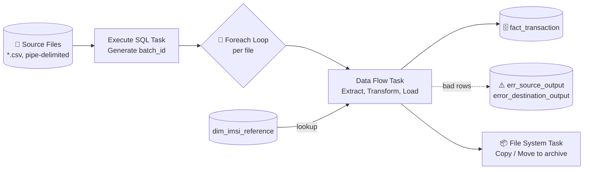

<div align="center">

# 📡 Telecom ETL Pipeline

**An end-to-end SSIS solution that ingests raw telecom transaction files, cleanses and enriches them, and loads them into a SQL Server data warehouse, with full error capture at every stage.**


</div>

---

## 📑 Table of Contents

- [Overview](#-overview)
- [Business Requirements](#-business-requirements)
- [Architecture](#-architecture)
- [Control Flow](#-control-flow)
- [Data Flow](#-data-flow)
- [Transformation Rules](#-transformation-rules)
- [Database Schema](#-database-schema)
- [Package Variables](#-package-variables)
- [Project Structure](#-project-structure)
- [Getting Started](#-getting-started)
- [Error Handling Strategy](#-error-handling-strategy)
- [Notes & Known Limitations](#-notes--known-limitations)
- [Tech Stack](#-tech-stack)

---

## 🎯 Overview

Telecom operators generate millions of network events (calls, SMS, data sessions) every day, and the raw files are often incomplete or malformed. This project builds a **robust, re-runnable ETL pipeline** that:

- 📂 **Automatically discovers** every `.csv` file dropped in a source folder (Foreach Loop)
- 🧹 **Cleanses** the data: empty strings and invalid values become `NULL`
- 🔗 **Enriches** each transaction with its `subscriber_id` by looking up the IMSI in a reference dimension
- ✂️ **Derives** device attributes from the IMEI: **TAC** (Type Allocation Code) and **SNR** (Serial Number)
- 🗄️ **Loads** clean rows into a fact table using fast-load
- 🚨 **Never loses a row.** Bad records are redirected into dedicated error tables with the error code and column
- 📦 **Archives** processed files (move, or copy for testing) once loading finishes

---

## 📋 Business Requirements

**Case study: Telecom DWH.** A telecom company's source system generates a **CSV file every 5 minutes** containing customer transactions for a specific time window. The ETL must validate, transform and load that data into a data warehouse.

### Source file structure

| Column | Type | Length | Nullable | Sample |
|---|---|:---:|:---:|---|
| `ID` | Int | — | ❌ | `156` |
| `IMSI` | String | 9 | ❌ | `310120265` |
| `IMEI` | String | 14 | ✅ | `490154203237518` |
| `CELL` | Int | — | ❌ | `123` |
| `LAC` | Int | — | ❌ | `12` |
| `EVENT_TYPE` | String | 1 | ✅ | `1` |
| `EVENT_TS` | Timestamp | — | ❌ | `16/1/2020 7:45:43` |

### Mapping and validation rules

| Source | Rule | Target | Implemented by |
|---|---|---|---|
| `ID` | As-is | `transaction_id` | Direct mapping |
| `IMSI` | As-is, **reject if null** | `imsi` | Derived Column + `NOT NULL` target, rejects go to the error output |
| `IMSI` | Join with the IMSI reference table, **`-99999` if not found** | `subscriber_id` | `LKP Subscriber ID` + `DER Get Subscriber ID` |
| `IMEI` | First 8 characters, **`-99999` if null or length < 14** | `tac` | `DER Calculate SNR and TAC` |
| `IMEI` | Last 6 characters, **`-99999` if null or length < 14** | `snr` | `DER Calculate SNR and TAC` |
| `IMEI` | As-is | `imei` | Direct mapping |
| `CELL` | As-is, **reject if null** | `cell` | Derived Column + `NOT NULL` target |
| `LAC` | As-is, **reject if null** | `lac` | Derived Column + `NOT NULL` target |
| `EVENT_TYPE` | As-is | `event_type` | Direct mapping |
| `EVENT_TS` | Validate as datetime, **reject if invalid or null** | `event_ts` | Flat File Source type conversion + `NOT NULL` target |

### Rejected records

Rejected records are stored in **separate tables** (`err_source_output` and `error_destination_output`) instead of being dropped.

### File handling

After the valid data is loaded successfully, the processed CSV file is **moved** to the Archive / Processed folder.

---

## 🏗 Architecture



---

## 🔄 Control Flow

The package orchestrates the run in four steps. Each step below shows its part of the SSIS canvas.

### ① · Generate the batch id

<div align="center">
  
</div>

**Execute SQL Task** runs `SELECT MAX(batch_id) + 1 AS batch_id FROM dim_audit` to tag the current run. Only when it succeeds does the loop start.

### ② · Loop over the source files

<div align="center">
  
</div>

**Foreach Loop Container** enumerates every `*.csv` file in the source folder (driven by `User::ff_src_folder_path`). For each file it sets `ff_src_file_name`, and an expression rebuilds `ff_src_full_Path` so the Flat File connection points to the current file.

Inside the loop, the **Data Flow Task** runs the full extract, transform and load for that file (see [Data Flow](#-data-flow)).

### ③ · Archive the processed file

<div align="center">
  
</div>

After the Data Flow succeeds, one of two **File System Tasks** runs, chosen by a **precedence constraint with an expression** on the `move_copy` variable:

| Task | Runs when | Action |
|---|---|---|
| **FST- MOVE FILES** | `@[User::move_copy] == "move"` | Moves the file to the archive folder (`ff_dest_archive`) |
| **FST - COPY FILES** | `@[User::move_copy] == "true"` | Copies the file to the archive folder (useful for testing) |

> 💡 The archive behavior can be changed without touching the package logic.

---

## 🌊 Data Flow

The Data Flow Task runs once per file and moves each row through the stages below.

### ① · Read the file and catch bad lines

<div align="center">
  
</div>

**FF SRC Read Transactions** (Flat File Source) reads the pipe-delimited (`|`) file with a header row. Columns: `id, imsi, imei, cell, lac, event_type, event_ts`.

Lines that cannot be parsed leave through the red **Flat File Source Error Output** into **OLE DB Destination**, which writes them to `dbo.err_source_output`.

### ② · Cleanse and enrich with the subscriber

<div align="center">
  
</div>

- **Derived Column** cleanses the data: empty strings and invalid values become `NULL`, and columns are cast to the target types.
- **LKP Subscriber ID** (Lookup) matches `imsi` against `dbo.dim_imsi_reference` to retrieve `subscriber_id`.

### ③ · Derive the business columns

<div align="center">
  
</div>

- **DER Get Subscriber ID** replaces an unmatched (`NULL`) subscriber with the sentinel `-99999`.
- **DER Calculate SNR and TAC** splits the IMEI into **TAC** (first 8 characters) and **SNR** (last 6 characters), or `-99999` when the IMEI is null or shorter than 14.

### ④ · Load the fact table and capture rejects

<div align="center">
  
</div>

- **OLEDB DEST Load Transactions** fast-loads clean rows into `dbo.fact_transaction` (`TABLOCK`, `CHECK_CONSTRAINTS`).
- Rows rejected by the target (for example a `NULL` in a `NOT NULL` column) leave through the red **OLE DB Destination Error Output** into **OLEDB DEST Error Destination Outputs**, which writes them to `dbo.error_destination_output`.

---

## 🧪 Transformation Rules

| Column | Rule | Expression |
|---|---|---|
| `imsi` | Empty string becomes `NULL` | `imsi == "" ? NULL(DT_WSTR,9) : (DT_STR,9,1252)imsi` |
| `imei` | Empty string becomes `NULL` | `imei == "" ? NULL(DT_WSTR,14) : (DT_STR,14,1252)imei` |
| `cell` | `0` is treated as missing and becomes `NULL` | `cell == 0 ? NULL(DT_I4) : cell` |
| `lac` | Empty string becomes `NULL`, cast to `INT` | `lac == "" ? NULL(DT_I4) : (DT_I4)lac` |
| `event_type` | Empty string becomes `NULL` | `event_type == "" ? NULL(DT_WSTR,50) : (DT_STR,50,1252)event_type` |
| `event_ts` | Null-safe handling for the timestamp | `ISNULL(event_ts) ? NULL(DT_DATE) : event_ts` |
| `subscriber_id` | Unmatched IMSI gets a sentinel | `ISNULL(subscriber_id) ? -99999 : subscriber_id` |
| `tac` | First **8** characters of the IMEI | `(ISNULL(imei) \|\| LEN(imei) < 14) ? "-99999" : SUBSTRING(imei,1,8)` |
| `snr` | **Last 6** characters of the IMEI, after the TAC | `(ISNULL(imei) \|\| LEN(imei) < 14) ? "-99999" : SUBSTRING(imei,9,14)` |

> 🔑 **Sentinel value `-99999`** marks "unknown / not derivable" values, so downstream reports can filter them explicitly instead of dealing with `NULL`s.

---

## 🗃 Database Schema

**Database:** `SSIS_Telecom_DB`

### `dbo.fact_transaction`: clean, enriched events

| Column | Type | Nullable | Notes |
|---|---|:---:|---|
| `id` | `INT IDENTITY` | ❌ | Primary key |
| `transaction_id` | `INT` | ❌ | Source transaction id |
| `imsi` | `VARCHAR(9)` | ❌ | Subscriber identity |
| `subscriber_id` | `INT` | ✅ | From `dim_imsi_reference` (`-99999` if unmatched) |
| `tac` | `VARCHAR(8)` | ❌ | Derived from IMEI |
| `snr` | `VARCHAR(8)` | ❌ | Derived from IMEI |
| `imei` | `VARCHAR(14)` | ❌ | Device identity |
| `cell` | `INT` | ❌ | Cell tower id |
| `lac` | `INT` | ❌ | Location area code |
| `event_type` | `VARCHAR(50)` | ✅ | Type of event |
| `event_ts` | `DATETIME` | ❌ | Event timestamp |

### `dbo.dim_imsi_reference`: IMSI to subscriber lookup

A reference dimension with **1,000 rows** mapping `imsi` to `subscriber_id`.

### 🔴 Error tables

| Table | Captures | Extra columns |
|---|---|---|
| `dbo.err_source_output` | Lines the Flat File Source could not parse | `ErrorCode`, `ErrorColumn`, `audit_id` |
| `dbo.error_destination_output` | Rows rejected while loading `fact_transaction` (all columns kept as `VARCHAR` so nothing is lost on conversion) | `ErrorCode`, `ErrorColumn` |

---

## ⚙️ Package Variables

| Variable | Type | Purpose |
|---|---|---|
| `ff_src_folder_path` | String | Source folder scanned by the Foreach Loop |
| `ff_src_file_name` | String | Current file name (set by the loop) |
| `ff_src_file_extension` | String | File extension (`.csv`) |
| `ff_src_full_Path` | String | **Expression:** folder + file name + extension, used by the Flat File connection |
| `ff_dest_archive` | String | Archive folder for processed files |
| `move_copy` | String | Selects the archive behavior (copy or move) |
| `batch_id` / `audit_id` | Int | Run identifiers for auditing |
| `rc_*` | Int | Row counters (`pre_insert`, `extracted_processed`, `extracted_error`, `dest_error`) |

---

## 📁 Project Structure

```
Telecom-ETL/
├── 📄 README.md
├── 📂 docs/
│   └── 📂 images/
│       ├── 01_control_flow.png     # Full control flow
│       ├── 02_data_flow.png        # Full data flow
│       └── cf_*.png, df_*.png      # Per-step crops used in this README
├── 📂 sql/
│   ├── 01_Create_database.sql      # Database + fact & error tables
│   └── 02_Create_dim_imsi.sql      # IMSI reference dimension + data
└── 📂 Telecom ETL/                 # SSIS project (Visual Studio solution)
    ├── Telecom ETL.sln
    ├── Load Data.dtsx              # Main package
    ├── Project.params
    └── Telecom ETL.dtproj
```

---

## 🚀 Getting Started

### Prerequisites

- SQL Server (local instance, the package connects to `.`)
- Visual Studio with **SQL Server Integration Services Projects** extension
- **MSOLEDBSQL** provider

### Setup

**1️⃣ Create the database and tables**

```sql
-- Run in SSMS, in this order
sql/01_Create_database.sql
sql/02_Create_dim_imsi.sql
```

**2️⃣ Prepare the folders**

```
📂 Source Files/       ← drop your .csv files here
📂 Processed Files/    ← archive destination
```

**3️⃣ Open the solution** `Telecom ETL/Telecom ETL.sln` in Visual Studio.

**4️⃣ Update the package variables** to match your machine: `ff_src_folder_path`, `ff_dest_archive` and `move_copy`.

**5️⃣ Check the connection manager** `LocalHost.SSIS_Telecom_DB` (Data Source = `.`, Initial Catalog = `SSIS_Telecom_DB`).

**6️⃣ Run** the `Load Data.dtsx` package.

### Verify the load

```sql
SELECT COUNT(*) AS loaded_rows  FROM dbo.fact_transaction;
SELECT COUNT(*) AS source_errors FROM dbo.err_source_output;
SELECT COUNT(*) AS dest_errors   FROM dbo.error_destination_output;
```

---

## 🛡 Error Handling Strategy

The pipeline is designed so that **no row is silently dropped**:

```
 Source file ──► Flat File Source ──✖ parse error ──► err_source_output
                       │
                       ▼
              Cleanse ► Lookup ► Derive
                       │
                       ▼
               fact_transaction ──✖ load error ──► error_destination_output
```

- **Source errors** are redirected with the raw line, `ErrorCode` and `ErrorColumn`.
- **Destination errors** are redirected with every field preserved as text, so they can be inspected and replayed after fixing.
- **Unknown subscribers** and **invalid IMEIs** are loaded with the `-99999` sentinel instead of being rejected.

---

## 📝 Notes & Known Limitations

- 🔧 **Hard-coded paths:** the default variable values point to a local Windows folder. Update them for your environment.
- 🔧 **Copy/move switch:** the two precedence constraints test `@[User::move_copy] == "move"` and `@[User::move_copy] == "true"`. Make sure the variable value matches one of these so the intended File System Task runs.
- 🔧 **Source file name on rejected records:** the case study asks for the original CSV file name to be stored with every rejected record. The current error tables do not have a dedicated `file_name` column (only `audit_id` on `err_source_output`), so this is a recommended enhancement: add a `file_name VARCHAR(255)` column to both error tables and populate it from `User::ff_src_file_name`.
- 🔧 **`EVENT_TYPE` length:** the source defines it as 1 character, while the target column is `VARCHAR(50)`. This is more permissive than the spec.
- 🔧 **`dim_audit`:** the *Execute SQL Task* reads `batch_id` from `dim_audit`. Create this table (or adjust the query) before the first run, as it is not part of the provided scripts.

---

## 🧰 Tech Stack

| Layer | Technology |
|---|---|
| ETL | SQL Server Integration Services (SSIS) |
| Database | Microsoft SQL Server, T-SQL |
| IDE | Visual Studio 2022 (SSDT) |
| Source format | Pipe-delimited CSV |

---

<div align="center">

⭐ If you found this project useful, consider giving it a star!

</div>
